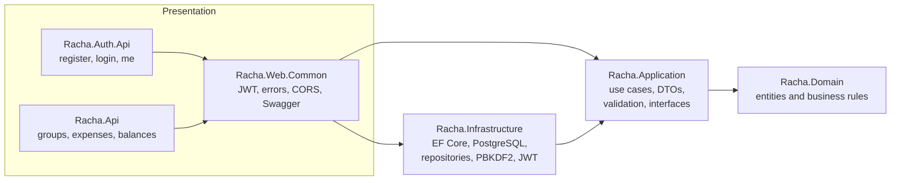
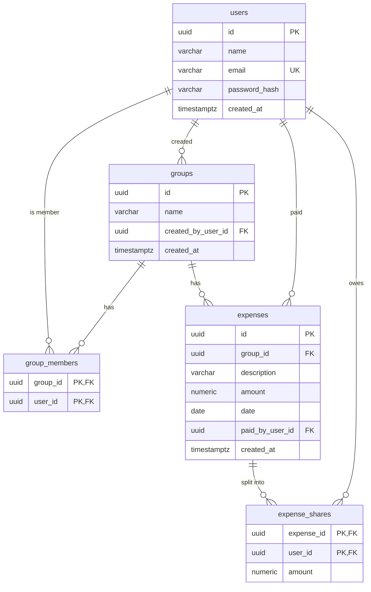

# Racha

> *"Rachar a conta"* is Brazilian slang for splitting the bill.

Racha is a simplified Splitwise. People in a group (a trip, a shared flat) record the expenses each one paid, and the app works out who owes whom and the fewest payments that settle everyone up.

It was built as a technical exercise: a .NET 8 backend following **Clean Architecture** and **TDD**, two ASP.NET Core Web APIs, PostgreSQL and an **Angular** frontend.

[](https://github.com/ViniciusMToigo/Racha/actions/workflows/ci.yml)

---

## Contents

- [User story](#user-story)
- [Quick start](#quick-start)
- [Demo credentials](#demo-credentials)
- [Architecture](#architecture)
- [API reference](#api-reference)
- [Tests](#tests)
- [Design decisions and trade-offs](#design-decisions-and-trade-offs)
- [What I would improve next](#what-i-would-improve-next)
- [Use of GenAI](#use-of-genai)

---

## User story

> **As a** member of a shared household or trip,
> **I want to** record expenses paid by any member of my group and see who owes whom,
> **so that** we can settle up fairly without doing the math by hand.

**Acceptance criteria**

1. I can create an account, log in, and only see the groups I belong to.
2. I can create a group and add other registered users to it by e-mail.
3. I can create, list, edit and delete the group's expenses (description, amount, date, who paid).
4. Each expense is split equally among the members. Leftover cents are distributed deterministically, so the shares always add up to the exact amount.
5. I can see each member's balance and a short list of suggested payments that settles the group.

---

## Quick start

### Prerequisites

| Tool | Version |
|---|---|
| .NET SDK | 8.0.x (pinned in `global.json`) |
| Docker Desktop | any recent version (runs PostgreSQL and the integration tests) |
| Node.js | 24.15+ or 26+ (required by Angular 22) |

### 1. Start the database

```bash
docker compose up -d
```

PostgreSQL 16 runs on `localhost:5432` (database `racha`, user `racha`, password `racha_dev_password`, local development only).

### 2. Run the two APIs

In two terminals, from the repository root:

```bash
dotnet run --project src/Racha.Api        # Expenses API on http://localhost:5080
dotnet run --project src/Racha.Auth.Api   # Auth API     on http://localhost:5090
```

In JetBrains Rider, the **"Racha (both APIs)"** run configuration (in `.run/`) starts both with one click.

On startup in Development, **Racha.Api applies the EF Core migrations and seeds demo data**. Start it at least once before using the Auth API.

### 3. Run the frontend

```bash
cd web
npm install
npm start                                  # http://localhost:4200
```

Open http://localhost:4200 and click **"Use it"** to fill in the demo account.

### Swagger

| API | URL |
|---|---|
| Auth API | http://localhost:5090/swagger |
| Expenses API | http://localhost:5080/swagger |

To call protected endpoints: log in with `POST /api/auth/login` on the Auth API, copy `accessToken`, click **Authorize** on either Swagger page and paste it.

---

## Demo credentials

Seeded automatically in Development (see `DatabaseSeeder`). All three users share the same password.

| User | E-mail | Password |
|---|---|---|
| Alice | `alice@racha.dev` | `Demo123!` |
| Bob | `bob@racha.dev` | `Demo123!` |
| Carol | `carol@racha.dev` | `Demo123!` |

Seeded groups: **"Trip to Floripa"** (Alice, Bob, Carol, created by Alice, 4 expenses) and **"Apartment 42"** (Bob, Alice, created by Bob, 2 expenses).

To start over with a clean database: `docker compose down -v && docker compose up -d`, then restart Racha.Api.

---

## Architecture

### Clean Architecture layers



Dependencies only point inwards. **Domain** has no dependencies at all. **Application** defines the interfaces it needs (`IUserRepository`, `IPasswordHasher`, `ITokenService`...) and **Infrastructure** implements them (dependency inversion), so the business rules never reference EF Core, PostgreSQL or ASP.NET.

| Project | Responsibility |
|---|---|
| `Racha.Domain` | Entities (`User`, `Group`, `Expense`) and pure business rules: `EqualSplitter` (split to the cent), `BalanceCalculator` (net balances), `DebtSimplifier` (suggested payments). |
| `Racha.Application` | Use cases (`AuthService`, `GroupService`, `ExpenseService`, `BalanceService`), DTOs, FluentValidation validators, authorization rules (who can see or change what) and application exceptions. |
| `Racha.Infrastructure` | EF Core `DbContext` and mappings, migrations, repositories, PBKDF2 password hashing, JWT issuing, demo seeder. |
| `Racha.Web.Common` | Shared web plumbing for both APIs: JWT validation, exception to ProblemDetails mapping, CORS, Swagger, base controller. |
| `Racha.Auth.Api` | Identity provider: issues tokens. |
| `Racha.Api` | Resource server: validates tokens and serves groups, expenses and balances. |
| `web/` | Angular 22 frontend. |

### Two APIs: identity provider and resource server

The exercise asks for a second API for users and login. The split also follows a common real-world pattern:

- **Racha.Auth.Api** knows about passwords and *issues* JWTs.
- **Racha.Api** never sees a password. It only *validates* JWTs and serves the business data.

Both read the same `Jwt` settings. In this exercise they share one database and a symmetric key; see the [trade-offs](#design-decisions-and-trade-offs) for how this would change in production.

### Database



- Money is `numeric(12,2)`, never floating point.
- Deleting a group cascades to its memberships, expenses and shares. Users are never deleted by cascade.
- `users.email` has a unique index: the real guarantee against duplicate sign-ups, even when two requests race.
- Tables and columns use PostgreSQL's snake_case convention.

### Frontend

```
web/src/app/
  core/       auth (signal-based service, JWT interceptor, route guards), typed API clients, models, ProblemDetails helpers
  features/   auth/, groups/, expenses/, balances/: one folder per feature, lazy-loaded pages
  shared/     reusable dialogs
```

- Standalone components, **signals** for state and `rxResource` for loading, error and data states.
- Angular Material, responsive from 360px phones to desktop.
- The interceptor attaches the token **only to our own APIs**, and ends the session if the API rejects the token.

---

## API reference

All errors use the [RFC 9457 ProblemDetails](https://www.rfc-editor.org/rfc/rfc9457) format. Validation errors include an `errors` object keyed by camelCase field name.

### Auth API (`:5090`)

| Method | Route | Auth | Success | Errors |
|---|---|---|---|---|
| GET | `/api/health` | public | 200 | |
| POST | `/api/auth/register` | public | 201 + token | 400 validation, 409 e-mail taken |
| POST | `/api/auth/login` | public | 200 + token | 400, 401 invalid credentials |
| GET | `/api/auth/me` | token | 200 user | 401 |

### Expenses API (`:5080`), every route requires a token

| Method | Route | Success | Notes |
|---|---|---|---|
| GET | `/api/groups` | 200 | groups the user belongs to |
| POST | `/api/groups` | 201 + `Location` | the creator becomes the first member |
| GET | `/api/groups/{groupId}` | 200 | members only, otherwise 404 |
| PUT | `/api/groups/{groupId}` | 200 | rename, **creator only** (403 for other members) |
| DELETE | `/api/groups/{groupId}` | 204 | **creator only**, deletes its expenses too |
| POST | `/api/groups/{groupId}/members` | 200 | add a registered user by e-mail |
| GET | `/api/groups/{groupId}/expenses` | 200 | newest first |
| POST | `/api/groups/{groupId}/expenses` | 201 + `Location` | split equally among current members |
| GET | `/api/expenses/{expenseId}` | 200 | |
| PUT | `/api/expenses/{expenseId}` | 200 | re-splits among current members |
| DELETE | `/api/expenses/{expenseId}` | 204 | |
| GET | `/api/groups/{groupId}/balances` | 200 | balances and suggested transfers |

**Why 404 and not 403 for non-members?** Answering "forbidden" would confirm that the group exists. Outsiders get 404 for any id. 403 is only returned to members who can see the group but may not perform the action.

---

## Tests

```bash
dotnet test                       # backend: 189 tests (Docker must be running)
cd web && npm test                # frontend: 43 tests (watch mode)
cd web && npm run test:ci         # frontend, single run
```

| Project | Kind | What it covers |
|---|---|---|
| `Racha.Domain.Tests` (61) | unit | splitting to the cent, balances, debt simplification, entity invariants |
| `Racha.Application.Tests` (70) | unit, NSubstitute fakes | use cases, authorization rules, validators |
| `Racha.Infrastructure.Tests` (33) | integration, **real PostgreSQL via Testcontainers** | mappings, repositories, cascades, unique e-mail, seeder; PBKDF2 and JWT unit tests |
| `Racha.Auth.Api.Tests` (9) | end-to-end HTTP, `WebApplicationFactory` + Testcontainers | status codes, ProblemDetails, tokens |
| `Racha.Api.Tests` (16) | end-to-end HTTP, `WebApplicationFactory` + Testcontainers | full CRUD lifecycle, access rules, balances |
| `web` (43) | unit, Vitest | auth service, interceptor, guards, API clients, pages and dialogs |

**TDD.** Every backend layer was written test-first. The git history shows each step as a `test:` commit (failing tests and stubs) followed by a `feat:` commit (implementation).

**Why integration tests against a real database?** An in-memory provider doesn't enforce unique indexes, cascades or `numeric` precision. Testcontainers starts a disposable PostgreSQL 16, the same engine as production, and destroys it after the run.

**CI.** GitHub Actions runs the backend and frontend test suites and the production build on every push (`.github/workflows/ci.yml`).

---

## Design decisions and trade-offs

| Decision | Why | Trade-off / production alternative |
|---|---|---|
| PostgreSQL in Docker | Same setup on every OS; the SQL Server image does not run well on Apple Silicon. | Needs Docker. |
| Business rules in the Domain, orchestration in Application | Rules are tested without a database or HTTP; controllers stay one line each. | More projects than a simple CRUD would need. |
| Validation twice: FluentValidation + domain invariants | Validators give friendly per-field errors; the domain guarantees an entity can never be invalid. | Some rules are written twice. |
| Equal split in whole cents, leftover cents to the lowest ids | Shares always add up to the exact amount; same input, same result. | Only equal splits for now. |
| Greedy debt simplification | Guarantees at most *n − 1* payments and is easy to reason about. | The true minimum is NP-hard; not worth it for small groups. |
| PBKDF2-SHA256, 600,000 iterations, versioned hash format | Follows the current OWASP recommendation; the version and iteration count are stored, so the cost can be raised later. | Argon2id would be stronger but needs a third-party library. |
| JWT signed with HS256, shared by both APIs | Simple to run locally. | In production: **RS256** (only the Auth API holds the private key) or an identity provider such as Keycloak or Entra ID. |
| One database for both APIs | Simpler for the exercise. | In production the Auth API would own the users table. |
| Token stored in `localStorage` | Simple, survives a refresh; tokens are short-lived (60 min) and Angular escapes template output. | An httpOnly cookie avoids XSS token theft but needs CSRF protection. No refresh tokens yet. |
| Racha.Api migrates and seeds on startup (Development only) | One command to a working demo; only one API migrates, so there is no race. | In production migrations run as a reviewed deployment step (`dotnet ef migrations script --idempotent`). |
| Secure-by-default authorization | A fallback policy requires a token on every endpoint unless it is marked `[AllowAnonymous]`. | |

---

## What I would improve next

- Custom splits (by amount or percentage) and recording settlements ("Bob paid Alice R$ 30").
- Refresh tokens, RS256 keys and rate limiting on login.
- Pagination on the expense list.
- Removing members and leaving groups.
- End-to-end browser tests (Playwright) for the main user journey.
- Containerize the APIs and the frontend for a one-command `docker compose up`.

---

## Use of GenAI

This project was built with an AI pair-programmer (Claude). How the AI was used, where its output was validated, corrected or rejected, and the separate task-management-API exercise are documented in [`docs/genai.md`](docs/genai.md).
